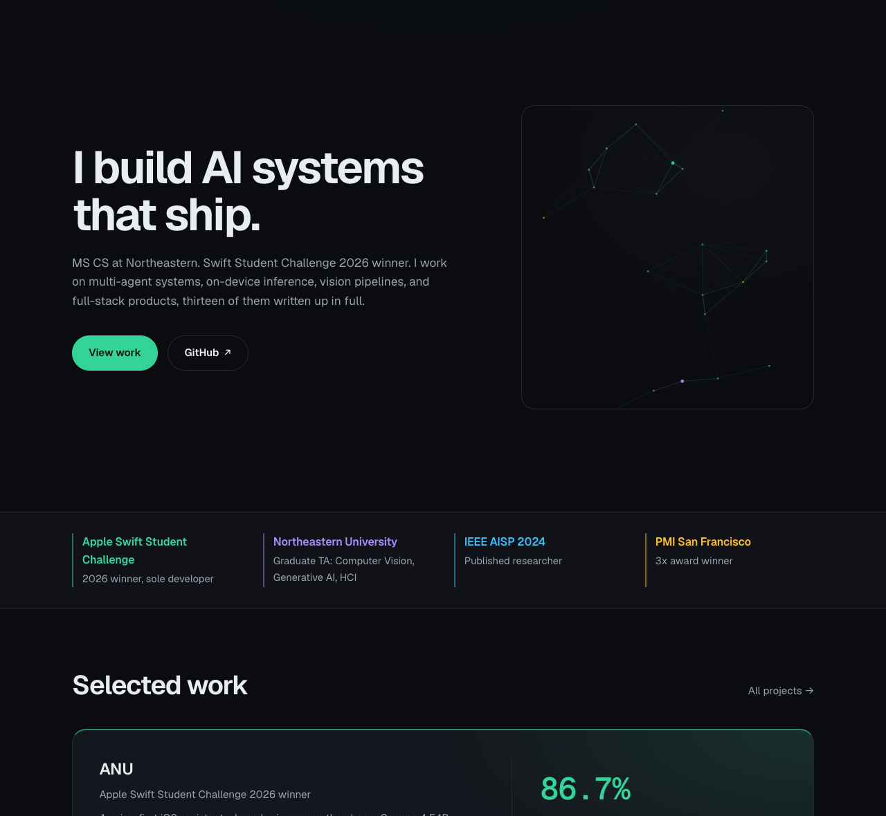

# sandeepvijayarao09.github.io

Personal portfolio of Sandeep Vijayarao, served by GitHub Pages at
**[sandeepvijayarao09.github.io](https://sandeepvijayarao09.github.io/)**.

<p align="center">
  
</p>

Static multi-page site, no build step: plain HTML, CSS, and vanilla JavaScript.

- `/` home, `/work/` projects (13 case studies), `/about/` experience and stack, `/contact/`
- `/open-source/`: the open-source journey, with every upstream pull request from both
  GitHub accounts pulled live from the GitHub API (`open-source/oss.js`, also used for
  the latest-PRs strip on the home page)
- `/RAG/`: an interactive, 15-level guide to building RAG systems from scratch
- Cross-page transitions via the CSS View Transitions API (progressive enhancement)
- Fonts (Geist and Geist Mono, OFL-licensed) self-hosted in `assets/fonts/`

## Local preview

```bash
python3 -m http.server 8000
# open http://localhost:8000
```

## Deploy

Push to `main`. GitHub Pages publishes the repo root automatically.
